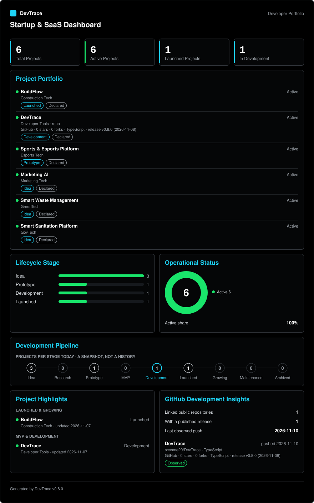

# DevTrace

Generate SVG indicators for your GitHub profile README from a small JSON configuration.

> Version 0.6.0. DevTrace is not published to npm yet: you run it from a clone of this repository.

## Project overview

DevTrace turns JSON files that describe your projects into static SVG images you can embed in a
GitHub profile README, in the spirit of GitHub Readme Stats and Shields.io. It runs on your machine
or in your own GitHub Actions workflow, so there is no hosted service, dashboard or account.

## Why DevTrace?

Most profile widgets count commits. DevTrace shows what only you know: which products you build,
in which stage they are, and how you work with AI. The data comes from your files, and each entry
records where it came from (`OBSERVED`, `DECLARED` or `ESTIMATED`). Nothing is invented, private
entries are never drawn, and the same input always produces the same SVG.

## Features

- Two indicators: **Startup & SaaS Statistics** and **AI Engineering Statistics**.
- Five themes (`DARK`, `LIGHT`, `MIDNIGHT`, `MINIMAL`, `TRANSPARENT`), three layouts, custom
  colors, fonts and dimensions.
- A `validate` command that names the file, the field and a fix for every problem, and changes
  nothing.
- Optional, read-only GitHub integration for public repository data.
- An optional GitHub Actions workflow that regenerates and commits the SVGs.
- Private entries are removed before any statistic is computed.
- Static SVGs with no scripts, no remote resources and escaped text.

## Preview



The image above is generated from this repository's own `data/startup.json`. See
[`examples/`](examples) for complete configuration files and [customization](docs/customization.md)
for the other themes.

## Quick start

Requires Node.js 22+ and pnpm 9.

```bash
git clone <url-of-your-copy-of-devtrace> devtrace
cd devtrace
pnpm install
pnpm dev init          # creates data/startup.json and data/ai-engineering.json
# edit the files in data/ (copy from examples/ if you like)
pnpm validate          # checks the files, writes nothing
pnpm generate          # writes public/indicators/*.svg
```

The full walkthrough is in [docs/getting-started.md](docs/getting-started.md).

## Installation

DevTrace is used from a clone of the repository; the package is `private` and is not on the npm
registry. `pnpm install` installs the dependencies. `pnpm build` compiles to `dist/`, and
`node dist/index.js <command>` runs the build. The package declares a `devtrace` binary for when
it is distributed that way, but nothing is published.

## Configuration

DevTrace reads `data/startup.json`, `data/ai-engineering.json` and, optionally,
`data/github.json`. Every file rejects unknown fields and is validated before anything is written.

- [Configuration overview](docs/configuration.md): files, examples, precedence, privacy.
- [Data model](docs/data-model.md): every field, its type, whether it is required and its default.
- [SVG components](docs/svg-components.md): the reusable chart, metric and layout components for contributors.
- [`examples/`](examples): complete files for startup, AI engineering, `LIGHT` with `COMPACT`,
  custom colors and GitHub. A test validates each of them.

Environment variables: only `GITHUB_TOKEN`, optional, read by `sync` and never stored or printed.

## CLI commands

| Command                        | Purpose                                                          |
| ------------------------------ | ---------------------------------------------------------------- |
| `devtrace init`                | Create valid, empty starter files in `data/`                     |
| `devtrace validate [target]`   | Check the configuration; writes nothing                          |
| `devtrace generate [target]`   | Write the SVGs. Options: `--theme`, `--layout`, `--output`       |
| `devtrace sync [--force]`      | Read public GitHub data (the only command that uses the network) |
| `devtrace --help`, `--version` | Help and version                                                 |

Exit codes: `0` success, `1` failure, `2` usage error. In this repository run it with
`pnpm dev <command>`, or with the scripts `pnpm validate`, `pnpm generate`,
`pnpm generate:startup`, `pnpm generate:ai` and `pnpm sync:github`. Full reference:
[docs/cli-reference.md](docs/cli-reference.md).

## Available indicators

| Indicator                 | File                                         | Shows                                                                     |
| ------------------------- | -------------------------------------------- | ------------------------------------------------------------------------- |
| Startup & SaaS Statistics | `public/indicators/startup-stats.svg`        | Project totals, lifecycle distribution, status, links                     |
| AI Engineering Statistics | `public/indicators/ai-engineering-stats.svg` | Tools, models, skills, AI projects; activity and token usage when enabled |

Details and definitions: [docs/indicators.md](docs/indicators.md).

## Themes and customization

`settings.theme` selects `DARK` (default), `LIGHT`, `MIDNIGHT`, `MINIMAL` or `TRANSPARENT`.
`settings.layout` selects `COMPACT`, `DEFAULT` or `EXPANDED`. Colors, typography and dimensions can
be overridden one value at a time, and `--theme` / `--layout` override the file for a single run.

```json
{
  "settings": {
    "theme": "MIDNIGHT",
    "layout": "COMPACT",
    "colors": { "primary": "#ff79c6" }
  }
}
```

Precedence, ranges and contrast warnings are in [docs/customization.md](docs/customization.md).

## GitHub integration

Optional and read-only. `devtrace sync` reads public repository data (stars, forks, primary
language, latest release) into `data/github-snapshot.json`; `devtrace generate` then reads that
file and never uses the network. Declared values always win over observed ones, and a failed sync
leaves the previous snapshot and the SVG files untouched. A minimal `data/github.json`:

```json
{ "version": 1, "username": "your-github-username" }
```

Link a project with `"githubRepository": "owner/name"`. Details, rate limits and security notes:
[docs/github-integration.md](docs/github-integration.md).

## GitHub Actions

`.github/workflows/update-indicators.yml` runs on demand (**Actions → Update indicators → Run
workflow**) and once a day. It installs with pnpm on Node.js 22, runs the tests, syncs GitHub data,
generates both SVGs and commits them only when they changed. It requests `contents: write`, uses
the built-in `GITHUB_TOKEN` and publishes nowhere. See
[docs/github-integration.md](docs/github-integration.md#github-actions) for caveats such as
protected branches.

## Using the SVGs in your profile README

Commit the generated SVGs, then reference them. Replace `<username>` and `<repository>`; `HEAD`
points to the default branch, so no branch name is assumed.

```markdown

```

To show a light or a dark card depending on the viewer's GitHub theme, generate two files and use a
`<picture>` element:

```html
<picture>
  <source
    media="(prefers-color-scheme: dark)"
    srcset="
      https://raw.githubusercontent.com/<username>/<repository>/HEAD/public/indicators/startup-dark.svg
    "
  />
  /<repository>/HEAD/public/indicators/startup-light.svg"
    alt="Startup & SaaS Statistics"
    width="560"
  />
</picture>
```

```bash
pnpm dev generate startup --theme DARK --output startup-dark.svg
pnpm dev generate startup --theme LIGHT --output startup-light.svg
```

GitHub caches README images, so a new version can take a few minutes to appear.

## Data privacy and provenance

- `visibility` is required on every entry. `PRIVATE` entries are validated but removed before any
  count or drawing, so their names, descriptions and links never reach the SVG.
- Descriptions and URLs are not rendered as text. Token usage and cost are off unless you enable
  them.
- Every entry has a provenance. `OBSERVED` needs a verifiable source, and `ESTIMATED` must not be
  presented as fact. Only data read from GitHub is marked `OBSERVED` automatically.
- Credentials never belong in a configuration file: a `token` field is rejected, and a test scans
  the repository for credential patterns. The SVGs contain no scripts or remote references.

## Examples

See [`examples/`](examples). They use placeholder names such as `Example App`; replace them with
your own data. DevTrace does not ship invented metrics.

## Troubleshooting

Common messages and fixes are in [docs/troubleshooting.md](docs/troubleshooting.md). Add
`--verbose` to any command for every cause and the stack trace.

## Current limitations

- Not published to npm; the repository metadata (`repository`, `homepage`, `bugs`) is not set yet.
- GitHub is the only integration. AI tools, models, skills, activity and token usage are entered by
  hand, so only GitHub data is `OBSERVED`.
- GitHub data covers public repositories only: stars, forks, language, description and the latest
  release. There are no commit, pull request or contribution metrics.
- Cards have a configurable width but no pagination, so long lists make a tall card.
- Fonts are four system stacks and text width is estimated. Colors are solid hexadecimal values.
  See [customization](docs/customization.md#limitations).
- Scheduled workflows are disabled by GitHub after 60 days without repository activity.

## Contributing

See [CONTRIBUTING.md](CONTRIBUTING.md) and [docs/architecture.md](docs/architecture.md). Before a
pull request run `pnpm check` and `pnpm build`.

## License

MIT. See [LICENSE](LICENSE).
